# Presensi Siswa SMK TI Airlangga Samarinda

Aplikasi presensi sederhana untuk mencatat tap kartu RFID. Setiap tap siswa yang valid menyimpan NISN dan waktu secara otomatis. Aplikasi dibuat dengan PHP native, PDO, OOP, dan MariaDB.

## Menjalankan aplikasi

1. Nyalakan Apache dan MySQL/MariaDB di Laragon.
2. Impor file `schema.sql` melalui phpMyAdmin jika membuat database baru.
3. Jika pengaturan MariaDB berbeda, sesuaikan DSN, username, dan password pada constructor `Database` di `config/database.php`.
4. Buka `http://localhost/UUK_SULTHAN/`.
5. Masuk menggunakan akun awal `admin` dengan sandi `password`.

Seeder membuat akun administrator dan delapan kelas X/XI untuk jurusan PPLG, DKV, TJKT, dan MPLB. Untuk database yang sudah berisi data, jangan impor ulang sebelum membuat cadangan.

## Fitur

- Login dan logout administrator.
- CRUD kelas dan siswa.
- Simulasi tap kartu menggunakan NISN.
- Rekap presensi dengan filter tanggal, kelas, dan pencarian nama/NISN.
- Pencarian siswa.
- Tampilan responsif untuk layar ponsel.

## Susunan file

- `assets/logo-airlangga.png` — logo sekolah.
- `config/BaseModel.php` — abstract class induk model.
- `config/database.php` — koneksi database, model OOP, validasi, dan fungsi umum.
- `layouts/` — header, navigasi, dan footer.
- `index.php`, `login.php`, `logout.php` — ringkasan dan autentikasi.
- `kelas.php`, `siswa.php`, `pencarian.php` — kelola dan cari data.
- `tap.php`, `rekap.php` — simulasi tap dan rekap presensi.
- `schema.sql` — struktur database dan seeder.
- `style.css` — tampilan aplikasi.
- `docs/` — ERD dan screenshot halaman aplikasi.

## ERD

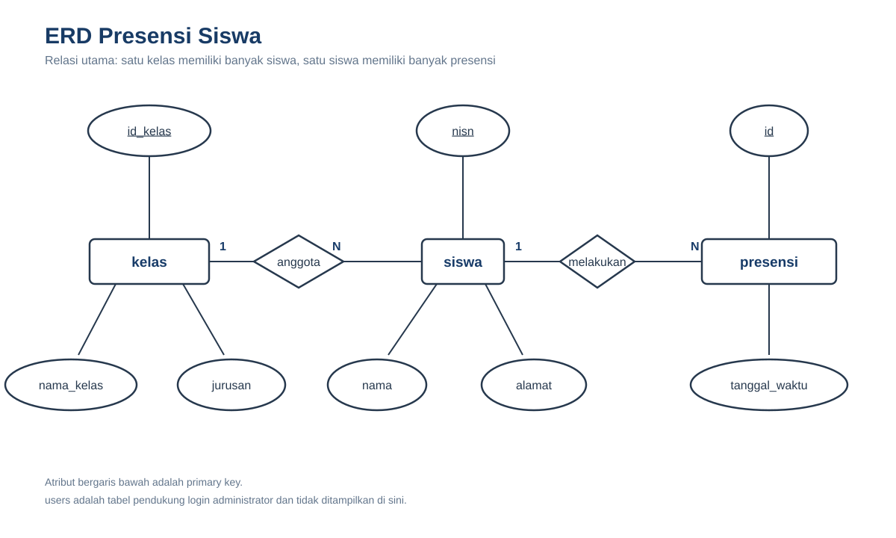

## Screenshot aplikasi

| Login | Dashboard |
|---|---|
| 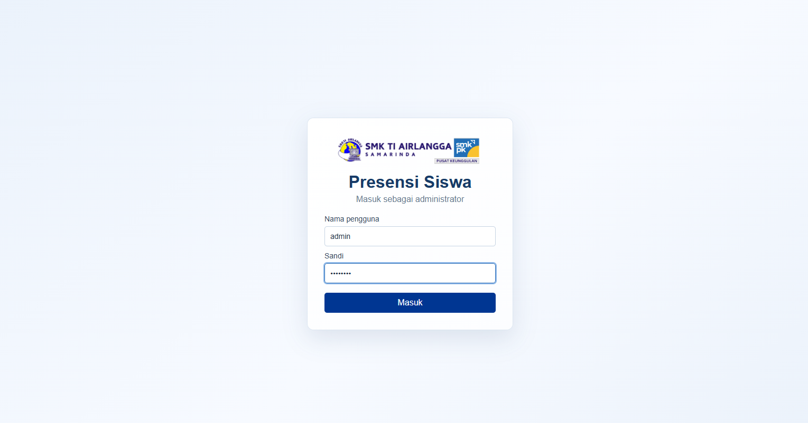 | 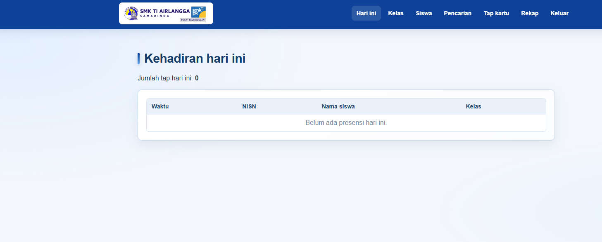 |

| Kelola kelas | Kelola siswa |
|---|---|
| 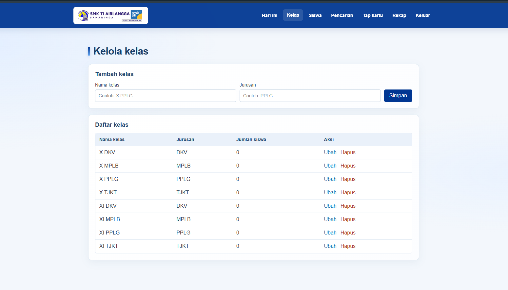 | 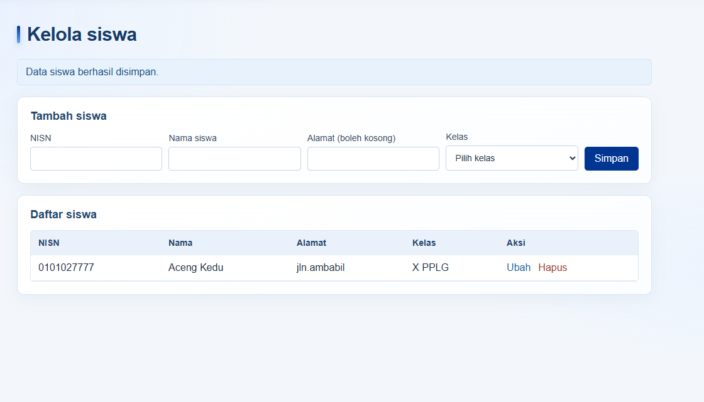 |

| Pencarian siswa | Simulasi tap kartu |
|---|---|
| 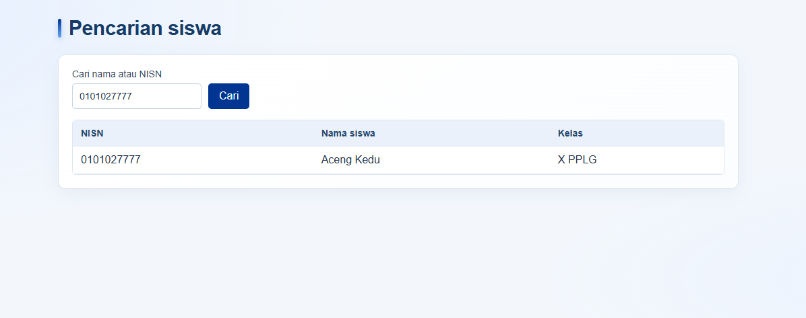 | 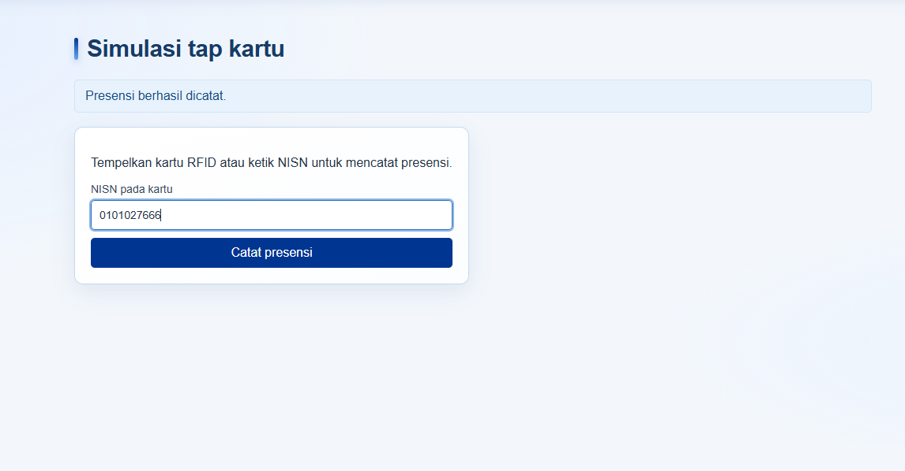 |

| Presensi hari ini | Rekap presensi |
|---|---|
| 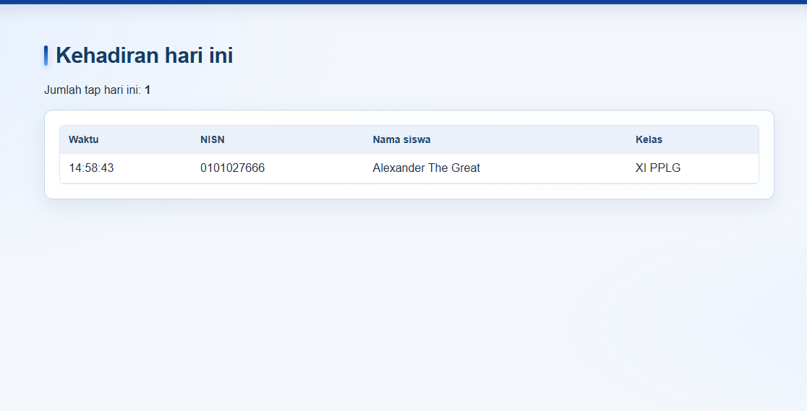 | 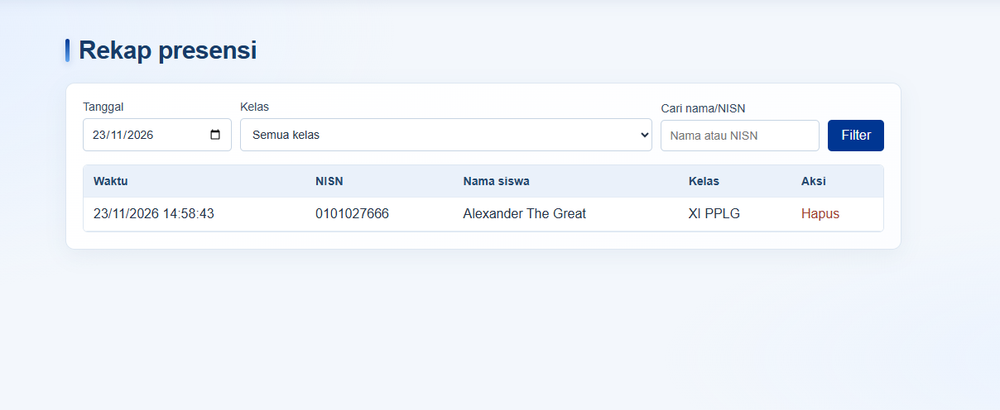 |

| Konfirmasi hapus presensi | Presensi setelah log dihapus |
|---|---|
| 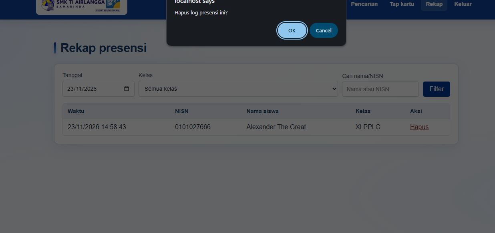 | 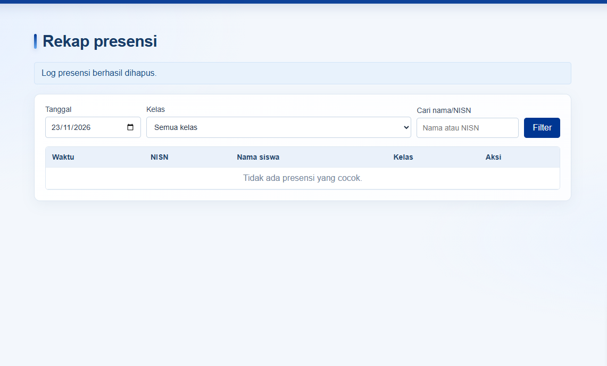 |

| Konfirmasi keluar | Pesan setelah kelas disimpan |
|---|---|
| 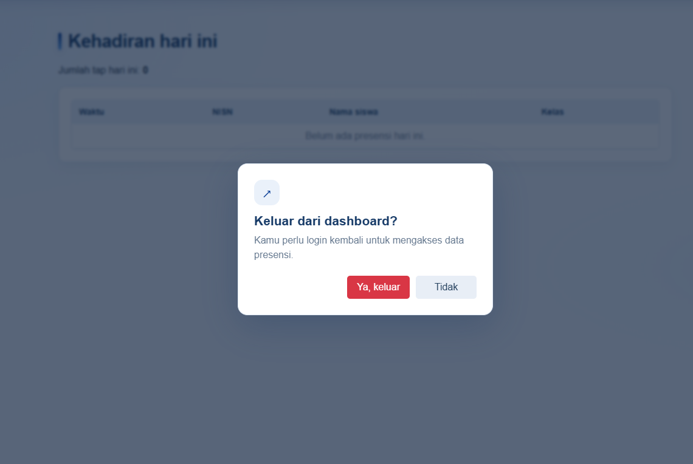 | 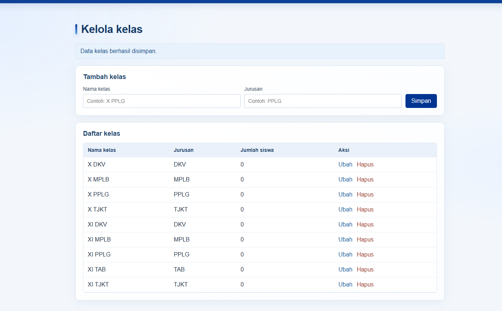 |

## Aturan data utama

- NISN harus berupa 10 digit angka dan disimpan sebagai teks.
- Nama siswa wajib diisi; alamat boleh kosong.
- Setiap tap valid menambah satu log presensi dengan waktu otomatis.
- Siswa yang tidak tap tidak mendapat baris presensi.
- Password disimpan menggunakan `password_hash()` dan diverifikasi menggunakan `password_verify()`.
- Query dengan input pengguna menggunakan prepared statement.
